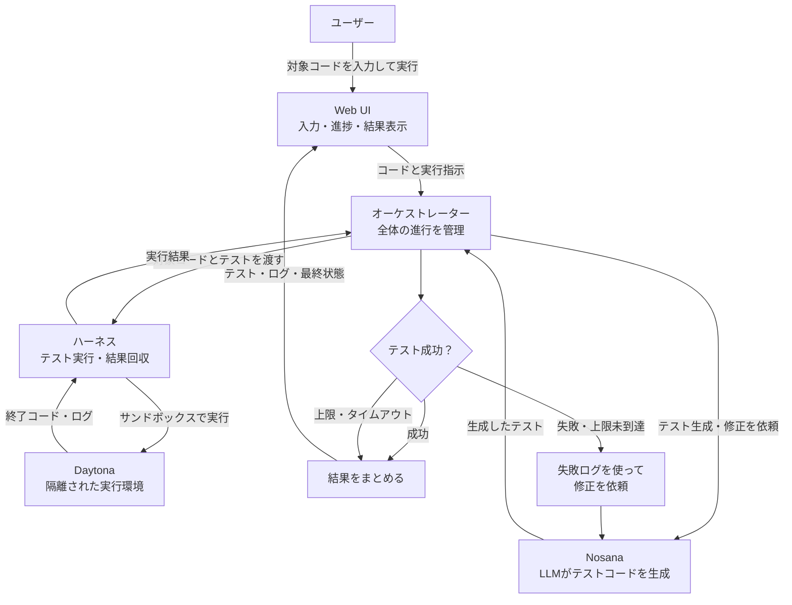

# テスト自動生成・修正ツールの構成

対象コードからテストを生成し、隔離環境で実行する。失敗した場合はログをモデルに渡して修正を依頼する。

- **Web UI**: 対象コードの入力、進捗と結果の表示。
- **オーケストレーター**: 生成、実行、判定、修正依頼の流れを管理。
- **ハーネス**: Daytonaでのテスト実行と結果の回収。
- **Nosana**: LLMによるテストコードの生成・修正。
- **Daytona**: テストを実行する隔離環境。

オーケストレーター担当の詳細は [task/orchestrator/task.md](task/orchestrator/task.md) を参照。
